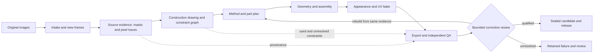

# Hull system architecture

Status: proposed integration contract, audited against the working tree on 2026-11-13. This document describes the existing software and the work needed to make its stages agree. It does not certify that arbitrary images already produce correct models.

## Product boundary

Hull should accept a supported image or view sheet and produce a reviewable 3D asset without an assistant choosing crops, parts, shapes, depths, or fixes for that asset. The source image is evidence. A rendered match is a hypothesis about geometry, materials, and lighting, not proof of physical construction. Unsupported or contradictory evidence must survive to the final report.

The factory has several specialist lines. They should share evidence, drawing, quality, and publication contracts while retaining the existing `hull`, `hull_parts`, `sheetset`, `atlas`, `facade`, `extrude`, and recipe machinery. Do not create a second general reconstruction pipeline.

The construction drawing is a **data contract**, not merely an image in a report. The builder must record the constraint IDs it consumed, the feature IDs it could not resolve, and the deviation of inferred geometry from observed pixel paths.

## Where the current system actually stands

| Boundary | Current owner | Verified capability and gap |
| --- | --- | --- |
| Entry and orders | `long-lines/tools/factory.py`; image-only `propkit/pipeline.py`; `propkit/sheet_blobs.py` | Multiple intake paths exist. Some older lines still depend on work-order grammar. The seven consumer-sheet pilot orders assigned five views, but companion parts and scale remain unresolved. |
| Source evidence | `propkit/drawing_traces.py`, silhouettes, reconciliation and preflight | The automatic-depth path creates `technical-traces.json` and `.png` before geometry, retaining source paths and 19 contour-crossing sections per elevation. Reconciled build pixels do not yet always map back to original pixels. |
| Construction plan | `propkit/process_planner.py`, `factory.py`, parts/section tools | A field, lathe, or fitted-section envelope can be selected from image evidence. The drawing's opposing-mask openings can reach the base hull. Most internal traces are not yet validated physical constraints; the planner and assembly lines do not all use one construction record. |
| Geometry | `propkit/hull.py`, `surface_detail.py`, `hull_assembly.py`, `parts_layout.py`, specialized lines | Signed fields, profiles, sections, parts, and relief exist. Physical-part ownership, camera/shape calibration, and robust separation of paint from relief remain incomplete. A smooth or textured result can still have incorrect clay geometry. |
| Appearance | `propkit/texturing.py`, `bake.py` and line-specific materials | UV projection and baking exist. Source-pixel ownership from the part graph is not yet enforced by the final texture projector. |
| Inspection and correction | `propkit/qa.py`, `stage_review.py`, `correction_review.py`, regression diagnostics | QA, stage review, and bounded correction guards exist. Their coverage differs by line and station. A visually persuasive proposal can still lose detail during field transfer, simplification, bake, or export. |
| Storage and maintenance | `propkit/warehouse.py`, `hull.py`, `factory/checks.json`, ledger | Candidates run in isolated folders and only qualified candidates can enter immutable releases. Qualification and storage checks do not establish physical accuracy. |

See [the factory manual](../long-lines/factory/README.md), [drawing status](TRACE_DRIVEN_DRAWING_STATUS.md), [process selection](../long-lines/factory/PROCESS_SELECTION.md), and [operations](../long-lines/factory/OPERATIONS.md) for implementation details and measured limits.

## Contracts to make the stages interoperable

These are target records. Existing JSON should be migrated or adapted incrementally; naming a record here does not claim it already exists as a type or schema.

1. **Source view.** Immutable image hash; sheet crop; original and working pixel frames; view and camera hypotheses; masks and confidence. Any transformed view carries a reversible coordinate mapping or an explicit provenance gap.
2. **Observation.** Source-view ID, original pixel path or region, extraction method, uncertainty, and competing interpretations. A dark circle can be an observed contour without becoming a bore.
3. **Drawing constraint.** Observation IDs from all supporting views, coordinate frames, cross-view mapping and reprojection residual, interpretation, and status (`observed`, `inferred`, or `unresolved`). Hidden lines, sections, and dimensions carry their assumptions. The drawing image is rendered from these records.
4. **Construction decision.** Which constraints support a part boundary, opening, profile, field, section, or relief; which alternatives were rejected and why; expected error and complexity budget. A decision cannot cite an object name as its geometric evidence.
5. **Build artifact.** Geometry, assembly transforms, physical-part IDs, UV ownership, source-to-surface correspondence, and a ledger of applied and unresolved constraint IDs. Preserve dense proposal, accepted field, and simplified/exported mesh as separate stages.
6. **Quality result.** Source-view reprojection, local feature and cross-section checks, clay and textured renders, surface error, topology, seams, triangle count, and uncertainty. Report changes from the previous candidate at the same input scale. QA is not allowed to erase a failed source constraint because an appearance score improved.
7. **Release receipt.** Input, source, toolchain, and artifact hashes; passed capability profiles; QA disposition; warnings and unresolved constraints; immutable release pointer. The existing warehouse provides much of this boundary.

Each record needs explicit units, coordinate frames, schema version, producer, and consuming stage. The source observation is never overwritten by a fitted curve or a corrected work image.

## Decision rules

- **Draw first, build second.** Source traces and uncertain interpretations exist before geometry. A drawing that is generated from the finished mesh is an inspection view, not independent source evidence.
- **Choose tools from evidence.** Compare field, planar, lathe, section, profile, and assembly hypotheses with the same source paths and quality budget. Simple planes should remain simple where relief evidence is absent; organic detail should remain where supported. Record the choice and alternatives.
- **Separate physical parts from surface regions.** A change in curvature, color, or triangle density alone does not justify a new part. Parts need ownership and mounting evidence; continuous surfaces should cross artificial construction-region boundaries without seams.
- **Separate geometry from appearance.** Evaluate material-only, recessed, and raised explanations against held-out pixels and cross-view evidence. Brightness gradients can propose local slopes, but single-image shading cannot determine unique physical depth without lighting/material assumptions.
- **Constrain every repair.** A retry starts from the same archived evidence and must improve its trigger while preserving silhouettes, local features, topology, ownership, and budget. Rejected proposals remain inspectable. A supervisor cannot silently flatten a detailed candidate to pass another check.
- **Do not promote one-object success.** The mixed-asset gate in `CONTRIBUTING.md` is required for every reconstruction feature: planar manufactured, curved manufactured, carved or organic, a negative control, and a held-out family. Compare the same inputs before and after.

## Integration sequence and closure gates

| Order | Work | Evidence required to close |
| --- | --- | --- |
| 1 | Establish a versioned source-view/observation/constraint schema and adapters for the current trace sheet. | Original source paths survive crops and reconciliation; deliberate missing mappings are visible; existing trace and intake tests still pass. |
| 2 | Make the construction drawing authoritative in the automatic-depth path, then extend the same record across other lines. Associate internal paths across views and retain competing interpretations. | Every resulting feature lists its source constraint IDs and reprojection residual; unsupported internal marks remain unresolved. Test openings and painted-seam negative controls. |
| 3 | Feed the drawing constraints into method selection, parts, assembly, and relief. Preserve separate evidence for planar areas and high-detail regions. | No selection by filename/category; measured improvement in source-linked geometry on the mixed set without worse control cases, seams, or triangle cost. |
| 4 | Carry physical and pixel ownership into texture projection and bake. | Every texel has a permitted source/part owner or a declared fallback; seam and duplicate-appearance checks pass on the mixed set. |
| 5 | Make stage comparison and correction coverage consistent from proposal through exported mesh. | A detail lost at field transfer, simplification, or export is attributed to the first failing station and cannot be hidden by a later appearance score. |
| 6 | Expose one read-only run API for an interface: source views, drawing, plan, stage previews, constraints used/unresolved, QA, and release status. | The interface reads recorded artifacts and invokes the existing factory, rather than reimplementing inference. |

Tickets should close only on their specific acceptance evidence. Existing issue and failure records are the work queue; do not open replacement tickets merely because a new module was added. The [implementation plan](../long-lines/factory/IMPLEMENTATION_PLAN.md) records experiments and historical results; this document defines how their outputs must connect.

## Repository and authority

- `long-lines/tools/propkit/`: numerical and reconstruction components. Keep numerical inference separate from Blender adapters, orchestration, and storage.
- `long-lines/tools/factory.py`: production orchestration and work-order compatibility.
- `long-lines/factory/`: standards, orders, gauges, ledger, release operations, and line instructions.
- `hull.py` and `long-lines/factory/checks.json`: maintenance and qualification commands; checks are registered once.
- `docs/`: architecture, measured milestone status, and research. `KNOWLEDGE_FILE.md` indexes verified behavior and limitations.
- `.hull-runs/` and release directories: generated evidence and immutable published outputs; keep them out of source-control cleanup experiments.

An interface belongs above these boundaries. It should present decisions and uncertainty and submit orders; it must not contain a second hidden geometry pipeline. Architectural changes should update this map, the affected station's documentation, and the relevant checks together.
