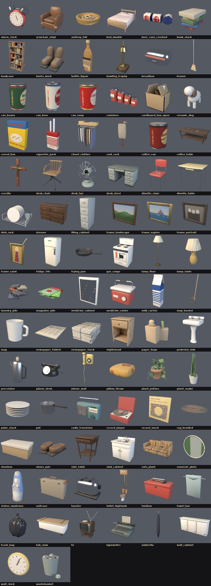
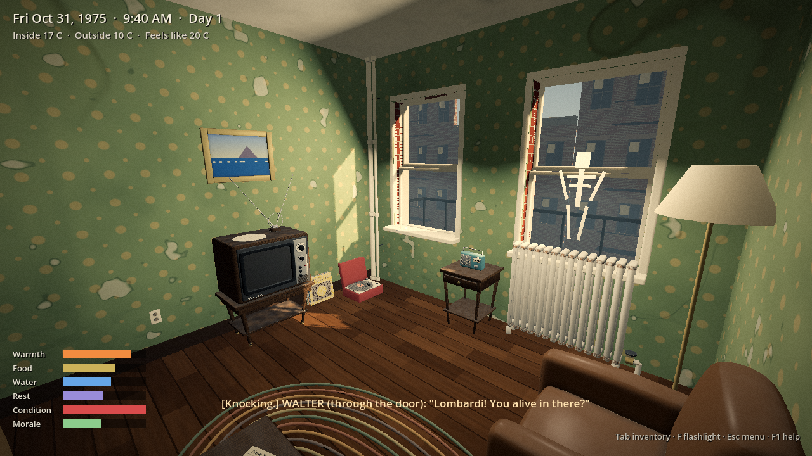
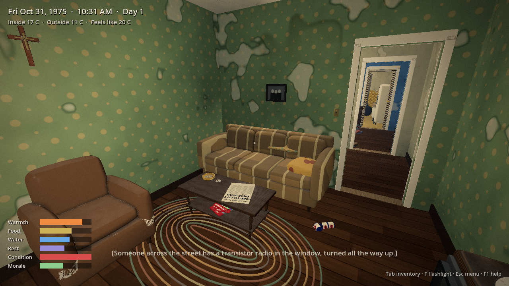
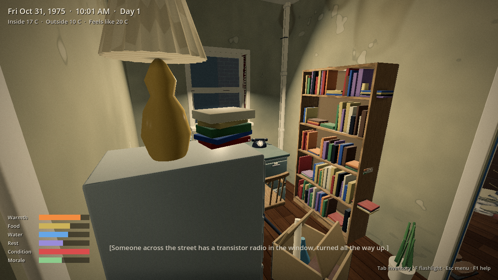
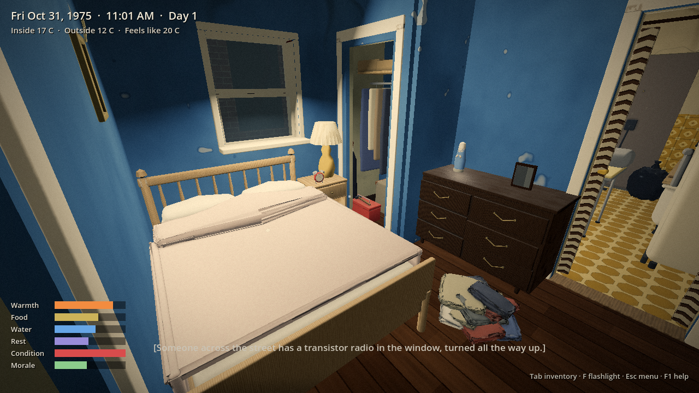
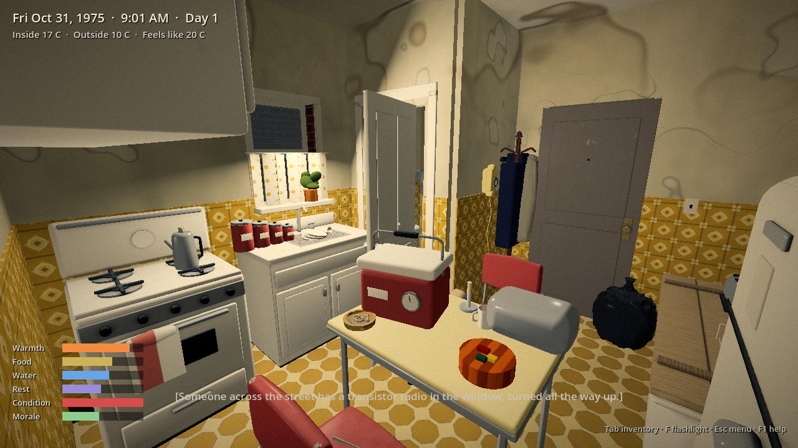
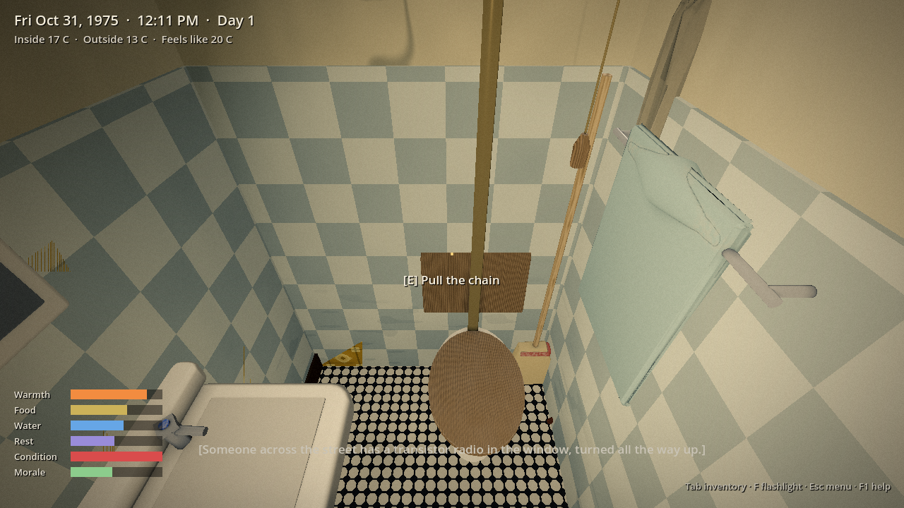
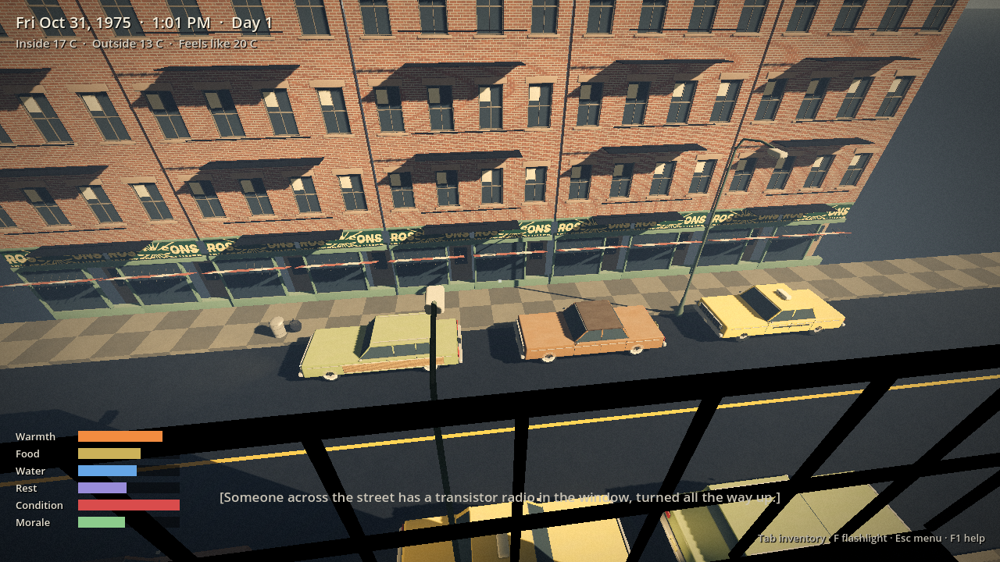
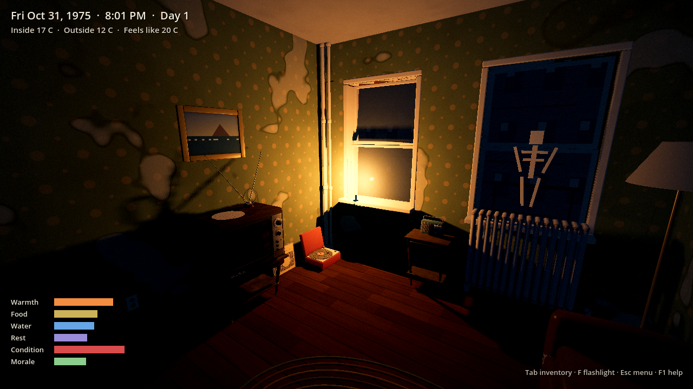

# Long Lines: apartment test slice

A first playable slice of *Long Lines*, built from the game design document. It covers only Nick Lombardi's apartment: 4A, a front railroad flat in an old-law tenement on Sullivan Street. Play starts at 6:40 a.m. on Friday, October 31, 1975, the morning after the comet. Stepping out the hall door ends the slice.

It is a Godot 4.4 project, as the design doc's technical plan specifies. Systems are data-driven from the first file, and every prop is generated in code (bevelled meshes and a painterly toon shader), so there are no art assets to import.


## Art pass: the kitchen

The kitchen is the test room for the final look. It combines 1970s New York apartment references with The Long Dark's rendering style:

- **Period dressing.** Octagon sheet linoleum, gold glazed tile up to 1.25 m, painted wooden cabinets with chrome pulls, a round-shouldered 1950s fridge, an apartment gas range with a clock in its back panel, a formica and chrome dinette, a tub on claw feet with a board lid, a yellow rotary phone, a milk-glass ceiling globe, cafe curtains, a curtain hung in the doorway, paper grocery bags, jars, and a percolator.
- **Chunky, bevelled props.** `Geo.rounded_box_mesh` rounds every edge. Edge vertices are tagged so the shader can lighten and chip them like painted wear.
- **Painted surfaces.** Procedural patterns, painted grain, grime blotches, and a dirty band low on the walls (`shaders/paint.gdshader`).
- **Lighting.** Forward+ renderer with ambient occlusion, a little bounced light, volumetric fog and glow. Warm practical lights against a cool teal ambient. Soft daylight spills in through each window, and the corners stay dark.
- **Grade.** Teal shadows, warm highlights, vignette and film grain (`shaders/grade.gdshader`).

The front room and bedroom have the new lighting and bevelled props but not yet their own dressing pass.

| Range, mid-morning | Candlelight, 9:30 p.m. |
| --- | --- |
|  |  |

## Run it

1. Install [Godot 4.4](https://godotengine.org/download) (the standard build, not .NET).
2. Open Godot, choose **Import**, and select `long-lines/project.godot`.
3. Press **F5** (Run Project).

Or from a terminal:

```bash
godot --path long-lines
```

## Controls

| Key | Action |
| --- | --- |
| WASD, mouse | Move, look |
| E | Use / primary action (also sets down whatever you're carrying) |
| R | Secondary action: pick up, climb out of an open window, open the freezer, cook |
| Q | Rotate the thing you're carrying |
| Mouse wheel or `[` `]` | Tune the radio (while looking at it or holding it) |
| F | Flashlight, once you've found it and only with a free hand |
| Tab | Inventory |
| C | Crouch |
| F5 / F9 | Quick save / quick load |
| Esc | Menu |
| F1 | Help |

## What's in the apartment

Three rooms in a row, at real tenement dimensions (3.4 m wide, 10.2 m deep, 2.75 m ceilings):

- **Front room.** Two east-facing windows onto Sullivan Street and the fire escape. A slipcovered sofa, a dead TV, the transistor radio, yesterday's paper ("FORD TO CITY: DROP DEAD"), a paper skeleton in the window, and the jack-o'-lantern out on the fire escape.
- **Bedroom.** Bed, dresser (cash, cigarettes, the prescription card), a photo of you and Terry, and an airshaft window.
- **Kitchen.** You enter from the hall here. Tub with a board lid, dead fridge and freezer, a working gas range, sink, cupboard, kitchen table with a drawer, the wall phone, the calendar, your coat on its hook, and the medicine cooler.

The street outside is dressed with dark tenements, Halloween paper in windows, a water tower, and cars left idling with their headlights on.


## Systems

| System | In this slice | Data |
| --- | --- | --- |
| Time | 1 game minute per real second; sleep skips time and wakes you for knocks | `tuning.json` → `time` |
| Climate | Design curve for days 1 to 7: 8 to 14 C on day 1, near freezing by day 7, with daylight dimming as soot spreads | `climate.json` |
| Needs | Warmth, food, water, rest, condition, morale | `tuning.json` → `needs` |
| Heat and air | One-zone room temperature and carbon monoxide. Burners and candles add heat and CO; each open window vents both. Headache, then dizziness, then drowsiness. Sleeping in bad air kills. | `tuning.json` → `air` |
| The cooler | Dial thermometer, ice that melts, 60 vials. Potency drops above 8 C and is ruined below 0 C. One dose a day; missed doses bring fever. Put it on the fire escape on cold nights. | `tuning.json` → `cooler` |
| Fridge and freezer | The fridge warms from 1 a.m. onward. The freezer stays frozen for about 22 hours, less each time you open it, then its ice trays melt one by one. Food spoils by temperature. | `tuning.json` → `fridge`, `items.json` |
| Inventory | Weight limit; every item ages on its own; tools gate actions (can opener, matches, a pot) | `items.json` |
| Carrying | Pick up props and set them on any flat surface, including the fire escape through an open window. The cooler takes both hands: no flashlight and slower walking. | |
| Radio | Six AM stations on day 1, fewer each day. EBS on 640, Civil Defense on 1240, all-news on 1130, an overnight call-in on 770, a DJ on 1550, a Spanish-language station on 1600. Batteries run down. | `radio.json` |
| Events | Captions on a schedule, with sound built by subtraction: horns and sirens on day 1, a car dying on day 2, bells and then silence on day 3. Walter knocks at 9:10 a.m., Concetta calls up the airshaft, and the Rivera kids trick-or-treat at 5:40 p.m. | `events.json` |
| Documents | Newspaper, notepad, calendar, photo, the Fear City pamphlet, a civil defense booklet, the prescription card, Concetta's note | `docs.json` |
| Save / load | All state, plus every prop's position, saved to `user://` | |

Things worth trying: fill the tub before the water goes, ration the freezer's ice into the cooler, make coffee on the range (then open a window), answer Walter, keep candy for the trick-or-treaters, and sleep with the gas on to see what happens.


## The prop library

Every object in the apartment, and the street outside, comes from one library of reusable parts: **108 props** built and baked by script in Blender at the fidelity of the TV prop. That covers furniture, appliances, consumer goods with invented 1970s packaging, decorations, junk, architectural pieces, building fronts and three cars.



**How it fits together (interchangeable parts):**

| Part | Where | Role |
| --- | --- | --- |
| Prop kit | `tools/propkit/` | Shared shapes (`core`), weathered materials (`mats`), period print graphics (`labels`), bake and export (`bake`) |
| Recipes | `tools/props/*.py` | One short `@prop` function per object, written against the kit |
| Builder | `tools/build_props.py` | Builds props by name or tag, bakes 128 to 2048 px textures, exports `assets/props/<name>/` |
| Catalogue | `assets/props/library.json` | Size, bounds, triangle count, texture size, tags and default behaviour for every prop |
| Loader | `PropFactory.from_entry()` | Places any library prop by name in any scene, with a behaviour kind |
| Layout | `data/apartment.json` | Rooms, walls, doorways and every placed object, as data |

```bash
# Build everything, or by name or tag (Blender 4.0+, apt python3-pil python3-numpy)
blender -b --factory-startup -P long-lines/tools/build_props.py -- all
blender -b --factory-startup -P long-lines/tools/build_props.py -- --tag kitchen
blender -b --factory-startup -P long-lines/tools/build_props.py -- --list
# Review grid
blender -b --factory-startup -P long-lines/tools/contact_sheet.py -- /tmp/sheet.png --tag decor
```

To place a prop in a scene, add one line to its layout JSON, for example
`{"type": "lib", "prop": "ashtray_full", "id": "ashtray", "pos": [2.6, 0.4, 2.6], "kind": "carry"}`.
Kinds are `static`, `fixture` (a "try it" response), `carry`, `container` (searchable) and `readable`. To give a gameplay object a library model, add `"model": "<prop>"` to its entry.

## The apartment

Nick's railroad flat, front to back: **front room**, **office** (steel desk, typewriter, filing cabinet, bookcase), **bedroom** with a **closet**, and the **kitchen** with a tenement **water closet** and the **entrance** from the stair landing. The hall door opens on its chain to show the landing and the door to 4B. Walls carry cracks, flaking paint, water stains and scuffs.

| | |
| --- | --- |
|  |  |
|  |  |
|  |  |
|  |  |

The street through the windows is assembled from library facade bays, cornices and shopfronts, with lampposts, hydrants, trash cans, and the three cars (sedan, taxi, station wagon) left where they stopped.

## Layout of the project

```
long-lines/
  data/            every tunable number, the layout, items, radio, events, documents
  scripts/core/    Data and Game autoloads
  scripts/sim/     pure simulation classes (clock, climate, needs, air, cooler, fridge, radio, inventory)
  scripts/world/   apartment builder, prop factory, player, interactables
  scripts/ui/      HUD and panels
  shaders/         paint.gdshader: toon ramp, painted grain, procedural patterns
  tests/           unit tests, an in-scene smoke test, a screenshot renderer
```

The apartment is built at runtime from `data/apartment.json`: walls with openings, rooms with their own floors and wallpaper, and props placed by position and rotation. To move the sofa, edit one line.

## Tests

```bash
# Unit tests for the simulation layer (39 checks)
godot --headless --path long-lines --script res://tests/run_tests.gd

# Scripted playthrough in the real scene: raycast interactions, carrying the
# cooler out to the fire escape, cooking with the windows shut, sleeping,
# saving and loading (44 checks)
godot --headless --path long-lines -- --smoke

# Render screenshots from fixed viewpoints and times (needs a display and
# Vulkan; on a headless Linux box, xvfb-run plus mesa-vulkan-drivers works).
# --only=k renders just the kitchen set.
godot --path long-lines -- --shots=/tmp/shots --only=k
```

The first run of a fresh checkout needs `godot --headless --path long-lines --import` so Godot can register the script classes.

## Differences from the design doc, for now

- **Built from scratch, not on Cogito.** The doc plans to start from the Cogito template. This slice needed only a small interaction and carry system, so it uses its own. Moving to Cogito when the building and street are added is still an option.
- **No audio yet.** Sound is shown as captions. The subtraction schedule is already in `events.json`, ready for an audio layer.
- **One air zone.** The doc imagines picking a warm room and sealing it off. Here the whole apartment shares one temperature and one CO level. Per-room zones are the next step for the shelter puzzle.
- **No glass breaking, nailing or taping, or fires spreading.** Windows open and close.
- **Renderer.** The project uses Forward+, which needs a Vulkan-capable GPU. For older hardware, switch `rendering/renderer/rendering_method` to `gl_compatibility`. It still runs, without ambient occlusion, volumetric fog or bounced light.
- **Toilets on the landing** (true to old-law tenements) are outside the slice.
- **Placeholder names.** The newspaper (*New York Daily Record*), food brands and radio station names are invented, as the doc requires. Real officials are never quoted.

## Next

The vertical-slice milestone in the design doc adds the rest of the building and Sullivan Street, days 1 to 7, Concetta and Walter as characters, keys and locked doors.
