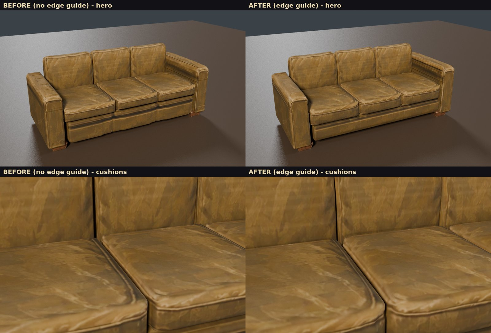
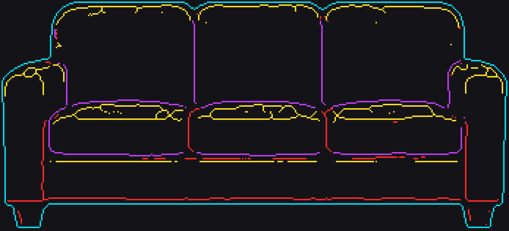

# Edge guide on the hull line: couch before/after (Nov 9)

Input: ChatGPT's annotated copy of the sofa parts sheet (Drive: Long Dark Style Game / Furniture /
"Vintage Sofa Orthographic Breakdown.png"). Red = separation between components, cyan = exterior,
yellow = rounded transition, purple = upholstery crease. Same code for both builds, guide off then on,
no manual edits to either mesh.

How the guide is used (`propkit/edge_guide.py`, `propkit/hull_assembly.py`):
- Classified by hue on saturated, bright pixels only (the painting never is). Each guide view is
  registered to its painted view by its filled cyan outline; fits under 0.85 are refused. All 17 used
  here fit 0.94-0.99. The guide's part rows have 3 views (front, side, top) against the painting's 5;
  they are matched by name.
- Machine mask per view: one-pixel lines labelled 1 cut, 2 exterior, 3 rounded, 4 crease (PNG) plus the
  lines as point lists (JSON), in the painted view's crop coordinates.
- Cyan: the registered outline replaces the painted-mask silhouette for carving.
- Red: in the parts line, the parts' split lines: cushion joins and the seat cushions' bottom came from
  it (instead of painted-seam detection and proportions). Not carved again (the parts are separate).
  In a single-hull build a red line becomes a narrow deep groove.
- Purple: a shallow groove pressed along the exact line on surfaces facing and visible from that view,
  before smoothing (about a third survives the hull's smoothing).
- Yellow: extra local smoothing near the line; never a cut.
- The guide is never used as texture.

| | Before (no guide) | After (guide) |
| --- | --- | --- |
| Gate | pass | pass |
| Triangles | 38,000 | 38,000 |
| Cushion joins | painted seams | edge guide |
| Seat cushion bottom | part proportions (0.29-0.31 m) | edge guide red line (0.256 m) |
| Guide edits | none | creases and rounding on all 9 hull parts; 0 grooves (structural cuts) |

Mesh difference (after vs before, nearest-surface distance): mean 5.47 mm, 95th percentile 21.18 mm, max 47.58 mm; most of the
large changes are the taller seat cushions and the smaller base rail below them.

Assessment: a real but modest improvement. The cushions are rounder, the piping crease along the seat
cushion fronts shows, the seat cushions sit at the height the guide says, the base rail is cleaner,
and the stripes on the left arm top are gone. The guide does not fix texture banding on the right arm's
inner face (a paint problem, not geometry). Some brush highlights in the guide's painting read as small
"rounded" squiggles inside cushions (they only add smoothing).
